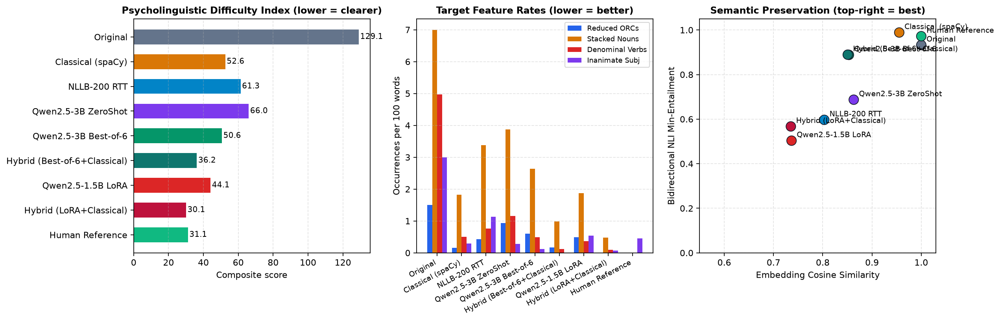

# psycholinguistic-reversal

Empirical study and runnable inference toolkit for **classically and neurally reversing** the six psycholinguistic difficulty features identified in [*Why is AI-generated language so hard to understand?* (Clark, Martin, & Mahowald, 2026; arXiv:2610.29162v1)](https://arxiv.org/abs/2610.29162).

## Overview

Modern post-trained LLMs overuse constructions that compress information density at the expense of human comprehension:

1. **Low-frequency / unattested n-grams** (measured against a human Brown + Reuters reference corpus)
2. **Long syntactic dependencies** (mean and sentence-length-standardized dependency arc length)
3. **Reduced object relative clauses (ORCs)** (omitting optional `that` / `which`)
4. **Stacked noun compounds** (3+ consecutive nouns in a modifier chain, e.g., *reader-patience budget*)
5. **Denominal verbs** (ad-hoc noun-to-verb conversions, e.g., *footnote it*, *calendar it*, *gate*, *sunset*)
6. **Inanimate subjects with animate verbs** (selectional-restriction violations, e.g., *`is_file()` swallows that*, *this asymmetry bites*)

This repository implements detectors for all six features, semantic/fluency/code-preservation evaluators, and seven reversal pipelines spanning symbolic rules, round-trip translation, zero-shot and Best-of-N neural rewriting, LoRA self-distillation, and hybrid neural+classical post-processing.



## Benchmark Results

Evaluated on 30 dense AI-style passages across three domains (**chat**, **coding**, and **essay**) plus 10 natural **human control** passages (to check against over-editing). Neural inference and LoRA training ran on an RTX 3080 (10 GB VRAM).

### Dense AI Test Set (30 passages)

| Method | Diff Score ↓ | Unatt. Bigram ↓ | Trigram PPL ↓ | Mean Dep Len ↓ | Red. ORC /100w ↓ | Stacked N /100w ↓ | Denom. V /100w ↓ | Inanim. Subj /100w ↓ | Cos Sim ↑ | NLI Min ↑ | GPT-2 PPL ↓ | Code Pres ↑ | Latency (ms) |
| :--- | ---: | ---: | ---: | ---: | ---: | ---: | ---: | ---: | ---: | ---: | ---: | ---: | ---: |
| Original | 129.1 | 0.752 | 81383.1 | 2.45 | 1.51 | 6.99 | 4.98 | 2.99 | 1.000 | 0.932 | 847.8 | 1.000 | 0 |
| Classical (spaCy) | 52.6 | 0.686 | 50574.1 | 2.49 | 0.15 | 1.83 | 0.51 | 0.29 | 0.955 | 0.989 | 798.1 | 1.000 | 6 |
| NLLB-200 RTT (En→Ja→En) | 61.3 | 0.510 | 15422.9 | 2.44 | 0.43 | 3.37 | 0.77 | 1.13 | 0.803 | 0.597 | 302.4 | 0.967 | 708 |
| Qwen2.5-3B ZeroShot | 66.0 | 0.609 | 30522.2 | 2.42 | 0.93 | 3.87 | 1.15 | 0.28 | 0.863 | 0.687 | 249.3 | 0.967 | 793 |
| Qwen2.5-3B Best-of-6 | 50.6 | 0.543 | 17660.3 | 2.32 | 0.60 | 2.63 | 0.49 | 0.12 | 0.853 | 0.888 | 205.5 | 0.967 | 1872 |
| **Hybrid (Best-of-6 + Classical)** | **36.2** | **0.524** | **15331.4** | **2.22** | **0.17** | **0.98** | **0.12** | **0.00** | **0.851** | **0.889** | **215.4** | **0.967** | **1878*** |
| Qwen2.5-1.5B LoRA | 44.1 | 0.455 | 12808.7 | 2.24 | 0.49 | 1.88 | 0.36 | 0.54 | 0.737 | 0.503 | 133.8 | 1.000 | 1706 |
| Hybrid (LoRA + Classical) | 30.1 | 0.447 | 11878.7 | 2.19 | 0.00 | 0.48 | 0.09 | 0.07 | 0.735 | 0.567 | 146.2 | 1.000 | 1706 |
| *Human Reference (10 control)* | *31.1* | *0.428* | *7190.8* | *2.53* | *0.00* | *0.00* | *0.00* | *0.46* | *1.000* | *1.000* | *145.3* | *1.000* | *-* |

*\*Hybrid (Best-of-6 + Classical) adds 6 ms of spaCy post-processing on top of the 1872 ms Best-of-6 pass.*

### Key Findings

* **Classical rules alone cut targeted feature counts cheaply (6 ms, NLI 0.989), but do not smooth global phrasing**: GPT-2 perplexity stays almost unchanged (`847.8 → 798.1`), and lexical coverage is bounded by the hand-authored denominal/animate-verb frame tables.
* **Round-trip translation (`NLLB-200`) smooths fluency (`847.8 → 302.4`) at the cost of semantic drift**: Bidirectional NLI drops to `0.597` (e.g., turning *"cache invalidation"* into *"cash-deactivation"* and flipping *"earliest"* to *"last"*).
* **Best-of-N psycholinguistic reranking (`Qwen2.5-3B-Instruct`) achieves the strongest neural trade-off**: Drops difficulty from `129.1 → 50.6` and GPT-2 perplexity `847.8 → 205.5` while keeping bidirectional NLI at `0.888` and leaving natural human control prose nearly untouched (`NLI 0.956`).
* **Hybrid (`Best-of-6 + Classical`) is the overall sweet spot**: Adds 6 ms of deterministic cleanup for residual reduced ORCs, noun stacks, and denominal/animate verbs—bringing the Difficulty Index to **`36.2`** (near the Human Reference of `31.1`), eliminating inanimate-subject metaphors (`0.00/100w`), and keeping bidirectional NLI at **`0.889`**.
* **Small LoRA self-distillation (`Qwen2.5-1.5B-Instruct`, 35 distilled pairs) matches human fluency (`GPT-2 PPL 133.8`) and `100%` code preservation**, but 1.5B capacity trades off semantic precision (`NLI 0.503–0.567`), indicating that larger backbones (3B–7B) or larger verified distillation sets are needed for single-pass deployment.

## Installation

```bash
uv venv --python 3.12 .venv
source .venv/bin/activate
uv pip install -e .
python -m spacy download en_core_web_sm
python -c "import nltk; [nltk.download(p) for p in ('wordnet','omw-1.4','brown','reuters','punkt','punkt_tab')]"
```

## Usage

### Analyze psycholinguistic features

```bash
psycho-rev analyze "Your instinct is right; the convoluted sentence you are currently reading is quietly eating its own reader-patience budget — footnote it."
```

### Rewrite text (classical or neural)

```bash
# Fast symbolic/spaCy reverser (CPU, ~6 ms)
psycho-rev rewrite --method classical "Right now \`is_file()\` swallows that permission error, which quietly sabotages the cache invalidation pipeline you added in \`src/cache/store.py\`."

# Neural open-weight options (GPU recommended)
psycho-rev rewrite --method nllb "..."
psycho-rev rewrite --method qwen "..."
psycho-rev rewrite --method best-of-n --samples 6 "..."
psycho-rev rewrite --method lora --adapter-dir checkpoints/qwen25-1.5b-psycho-rev-lora "..."
```

### Train LoRA adapter and run full benchmark

```bash
python -m psycho_rev.train_lora
python -m psycho_rev.evaluate
pytest -v
```

## Project Layout

* `src/psycho_rev/features.py` — Detectors for all six psycholinguistic features and composite Difficulty Index
* `src/psycho_rev/semantics.py` — MiniLM cosine similarity, DeBERTa-v3 bidirectional NLI entailment, GPT-2 fluency PPL
* `src/psycho_rev/code_guard.py` — Placeholder masking and restoration for inline code spans, paths, and function calls
* `src/psycho_rev/classical.py` — Deterministic spaCy dependency-tree + lexical frame reverser
* `src/psycho_rev/neural.py` — NLLB-200 RTT, Qwen2.5 zero-shot, Best-of-N psycholinguistic reranker, LoRA single-pass reverser
* `src/psycho_rev/train_lora.py` — Best-of-8 teacher self-distillation and PEFT LoRA fine-tuning for `Qwen2.5-1.5B-Instruct`
* `src/psycho_rev/evaluate.py` — Multi-domain benchmark runner, Markdown summary, and matplotlib visualization
* `results/` — Saved benchmark metrics (`benchmark_results.json`, `summary.md`, `distilled_train_pairs.json`, `comparison_plot.png`)
