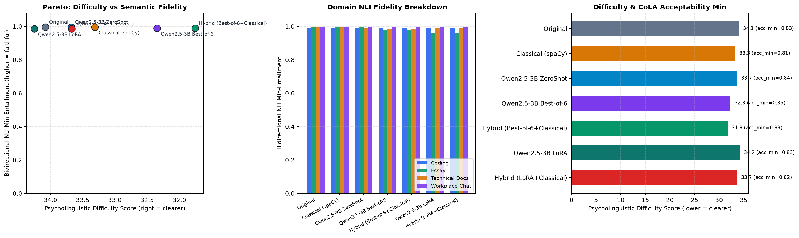

# psycholinguistic-reversal

Readability rewriter, psycholinguistic feature analyzer, and decoupled evaluation suite targeting the six comprehension-difficulty features identified in [*Why is AI-generated language so hard to understand?* (Clark, Martin, & Mahowald, 2026; arXiv:2610.29162v1)](https://arxiv.org/abs/2610.29162).

**Pretrained 3B QLoRA weights on Hugging Face:** [`8q0sb/qwen25-3b-psycholinguistic-reversal-lora`](https://huggingface.co/8q0sb/qwen25-3b-psycholinguistic-reversal-lora)

## Overview

Post-trained LLMs frequently pack dense syntactic and lexical constructions that reduce human reading comprehension:

1. **Low-frequency / unattested n-grams** (compared against NLTK Brown + Reuters + Webtext plus modern technical vocabulary)
2. **Long syntactic dependencies** (mean and sentence-length-standardized dependency arc length)
3. **Reduced object relative clauses (ORCs)** (omitting optional `that` / `which`)
4. **Stacked noun compounds** (3+ consecutive nouns in a modifier chain, e.g., *reader-patience budget*)
5. **Denominal verbs** (ad-hoc noun-to-verb conversions, e.g., *footnote it*, *calendar it*, *gate*, *sunset*)
6. **Inanimate subjects with animate verbs** (selectional-restriction violations, e.g., *`is_file()` swallows that*, *this asymmetry bites*)

This package provides:

* **Production CLI, Python SDK, and local HTTP server** (`psycho-rev rewrite`, `psycho-rev analyze`, `psycho-rev serve`, `from psycho_rev import Rewriter`) with stdin/pipe support, unified `--diff` previews, and `--in-place` file editing.
* **Multiple backends**: OpenAI-compatible HTTP endpoints (`openrouter`, `openai`, vLLM, Ollama, llama.cpp), local `Qwen2.5-3B` (zero-shot, decoupled Best-of-N, and QLoRA SFT + SimPO), and a safe-mode deterministic spaCy pass.
* **Hardened technical-text protection (`code_guard.py`)**: Collision-free single-pass masking for fenced code blocks, inline code, YAML frontmatter, Markdown links, HTML/XML tags, CLI flags, environment variables, URLs, and file paths, plus structure-preserving long-document chunking.
* **Clarity no-op gate**: Automatically skips already-clear prose (`difficulty_score < 35.0`) so clean human or frontier-model text is not churned unnecessarily.
* **Decoupled evaluation & real-world OOD corpus pipeline**: Resumable multi-model corpus generation (`corpus_builder.py`), 100%-out-of-lexicon OOD test splitting, independent held-out scoring (`nli-deberta-v3-base`, `gpt2-medium` perplexity, `roberta-base-CoLA` grammatical acceptability), and position-swapped blind pairwise LLM-as-a-judge (`judge.py`).

## Installation

```bash
uv venv --python 3.12 .venv
source .venv/bin/activate

# Core install (CLI, SDK, HTTP server, OpenAI/OpenRouter HTTP backends, classical spaCy)
uv pip install -e .

# With local PyTorch / Transformers / QLoRA training & evaluation dependencies
uv pip install -e ".[ml]"

python -m spacy download en_core_web_sm
python -c "import nltk; [nltk.download(p) for p in ('wordnet','omw-1.4','brown','reuters','webtext','punkt','punkt_tab')]"
```

## Quick Start

### CLI

```bash
# Rewrite via OpenRouter or OpenAI (no local GPU required)
export OPENROUTER_API_KEY=...
psycho-rev rewrite --method openrouter --diff --file draft.md

# Pipe from stdin and inspect a unified diff
cat notes.md | psycho-rev rewrite --method openrouter --diff

# Edit a Markdown file in place with code/frontmatter/link protection
psycho-rev rewrite --method openrouter --in-place --file docs/guide.md

# Local GPU inference (Qwen2.5-3B LoRA or Best-of-N)
psycho-rev rewrite --method lora --adapter-dir 8q0sb/qwen25-3b-psycholinguistic-reversal-lora --file draft.md --plain
psycho-rev rewrite --method best-of-n --samples 6 --file draft.md --plain

# Analyze psycholinguistic difficulty features (JSON or text)
psycho-rev analyze --file draft.md --json

# Run a local HTTP JSON server on 127.0.0.1:8787 (/health, /analyze, /rewrite)
psycho-rev serve --method openrouter --port 8787
```

### Python SDK

```python
from psycho_rev import Rewriter

with Rewriter(backend="openrouter", model="openai/gpt-4o-mini") as rw:
    result = rw.rewrite("Right now `is_file()` swallows that permission error.")
    print(result.rewritten)
    print(result.code_preservation, result.skipped_as_clear)
```

### Corpus Generation, Training, and Decoupled Evaluation

```bash
# Generate multi-model real LLM corpus, build 100%-OOD split, and distill teacher pairs
psycho-rev build-corpus all \
  --provider openrouter \
  --models openai/gpt-4o-mini meta-llama/llama-3.3-70b-instruct qwen/qwen-2.5-72b-instruct \
  --teacher-model openai/gpt-4.1-mini \
  --samples-per-model 200 \
  --max-cost-usd 4.50 \
  --resume

# Train 4-bit QLoRA (Stage 1 SFT + Stage 2 hard-negative SimPO with val checkpoint selection)
python -m psycho_rev.train_lora \
  --dataset-path ~/.local/share/psycholinguistic-reversal/datasets/distilled_pairs.jsonl \
  --output-dir checkpoints/qwen25_3b_v2_lora \
  --epochs 3 --dpo-epochs 2 --max-length 1024

# Run decoupled held-out evaluation + position-swapped blind pairwise judge on OOD split
psycho-rev evaluate \
  --dataset-path ~/.local/share/psycholinguistic-reversal/datasets/test_ood.jsonl \
  --adapter-dir checkpoints/qwen25_3b_v2_lora \
  --results-dir results_ood \
  --skip-nllb --blind-judge --judge-model openai/gpt-4.1-mini
```

## Decoupled Benchmark Results

Evaluation uses a two-phase pipeline that separates reranking proxies (`nli-deberta-v3-small`, `gpt2`) from held-out evaluation (`cross-encoder/nli-deberta-v3-base`, `gpt2-medium` strided perplexity, and `textattack/roberta-base-CoLA` grammatical acceptability), plus a position-swapped blind pairwise LLM judge (`openai/gpt-4.1-mini`).

### 1. Real-World Out-of-Lexicon OOD Test Set (71 multi-model LLM passages)

Sampled across `coding`, `technical_docs`, `essay`, and `workplace_chat` from `openai/gpt-4o-mini`, `meta-llama/llama-3.3-70b-instruct`, and `qwen/qwen-2.5-72b-instruct` with 100% out-of-lexicon coverage (zero verbs from the classical lexicon):

| Method | Diff ↓ | Cos Sim ↑ | NLI Min ↑ | Contra ↓ | PPL ↓ | Acc Mean / Min ↑ | Code Pres ↑ | Blind Judge vs Orig (Win / Tie / Loss) |
| :--- | ---: | ---: | ---: | ---: | ---: | ---: | ---: | ---: |
| Original | 34.1 | 1.000 | 0.995 | 0.001 | 17.5 | 0.942 / 0.835 | 1.000 | — |
| Classical (spaCy safe) | 33.3 | 1.000 | 0.995 | 0.001 | 17.3 | 0.939 / 0.813 | 1.000 | 0.0% / 85.7% / 14.3% |
| Qwen2.5-3B ZeroShot | 33.7 | 0.984 | 0.994 | 0.001 | 18.5 | 0.948 / 0.845 | 1.000 | 0.0% / 74.3% / 25.7% |
| Qwen2.5-3B Best-of-6 | 32.3 | 0.984 | 0.988 | 0.014 | 18.1 | 0.947 / 0.845 | 1.000 | 0.0% / 65.7% / 34.3% |
| Hybrid (Best-of-6+Classical) | 31.8 | 0.984 | 0.988 | 0.014 | 18.1 | 0.945 / 0.830 | 1.000 | 0.0% / 57.1% / 42.9% |
| Qwen2.5-3B LoRA (v2) | 34.2 | 0.993 | 0.984 | 0.001 | 18.0 | 0.943 / 0.831 | 1.000 | 0.0% / 74.3% / 25.7% |
| Hybrid (LoRA+Classical) | 33.7 | 0.993 | 0.984 | 0.001 | 18.0 | 0.941 / 0.817 | 1.000 | 0.0% / 65.7% / 34.3% |



### 2. Dense AI Stress-Test Benchmark (Decoupled Held-Out + CoLA)

| Split / Method | Diff ↓ | Cos Sim ↑ | NLI Min ↑ | Contra ↓ | PPL ↓ | Acc Mean / Min ↑ | Code Pres ↑ |
| :--- | ---: | ---: | ---: | ---: | ---: | ---: | ---: |
| **Single-Sentence (30 passages)** — Original | 129.5 | 1.000 | 0.986 | 0.002 | 570.6 | 0.798 / 0.798 | 1.000 |
| Classical (spaCy safe) | 79.6 | 0.964 | 0.962 | 0.034 | 498.7 | 0.790 / 0.790 | 1.000 |
| Qwen2.5-3B ZeroShot | 73.6 | 0.909 | 0.898 | 0.033 | 244.5 | 0.896 / 0.896 | 1.000 |
| **Qwen2.5-3B Best-of-6** | **74.8** | **0.914** | **0.998** | **0.000** | **238.6** | **0.891 / 0.891** | **1.000** |
| Qwen2.5-3B LoRA (v2) | 98.7 | 0.955 | 0.793 | 0.035 | 430.7 | 0.873 / 0.864 | 1.000 |
| **Multi-Paragraph (18 passages)** — Original | 89.0 | 1.000 | 0.995 | 0.000 | 215.1 | 0.743 / 0.496 | 1.000 |
| Classical (spaCy safe) | 60.3 | 0.985 | 0.980 | 0.000 | 199.7 | 0.747 / 0.499 | 1.000 |
| Qwen2.5-3B ZeroShot | 58.5 | 0.947 | 0.903 | 0.000 | 115.0 | 0.854 / 0.647 | 0.969 |
| **Qwen2.5-3B Best-of-6** | **53.1** | **0.956** | **0.996** | **0.000** | **115.7** | **0.853 / 0.638** | **1.000** |
| Qwen2.5-3B LoRA (v2) | 73.0 | 0.973 | 0.938 | 0.003 | 164.0 | 0.809 / 0.552 | 1.000 |


### Key Empirical Findings

* **Pure neural rewriting beats Classical post-processing on real prose:** On every split (OOD, dense single-sentence, dense multi-paragraph, and human control), appending `Classical (spaCy)` lowers minimum CoLA grammatical acceptability and increases blind-judge losses (`34.3% → 42.9%` on Best-of-6; `25.7% → 34.3%` on LoRA) even when it nudges the synthetic Difficulty Score down.
* **Small 3B models shine on genuinely dense prose, not already-clear 70B text:** On dense AI stress tests, de-leaked `Qwen2.5-3B Best-of-6` cuts perplexity by >50% (`570.6 → 238.6` single; `215.1 → 115.7` multi-para) and boosts CoLA grammatical acceptability by +9 to +14 points (`0.798 → 0.891`, `0.496 → 0.638` min) at `0.996–0.998` NLI and `100%` code preservation. On already-clear real LLM prose (`diff ≈ 34`, `PPL ≈ 17.5`), the clarity no-op gate prevents unnecessary churn, and API backends (`--method openrouter` / `openai`) are recommended when rewriting frontier-model text.
* **Human control preservation:** Both `Qwen2.5-3B LoRA (v2)` (`0.997–0.999` cosine, `0.995–0.997` NLI) and `Best-of-6` (`0.996–0.998` NLI) leave natural human prose intact.

## Project Layout

* `src/psycho_rev/rewriter.py` — High-level `Rewriter` Python SDK, `RewriteResult`, and `unified_diff`
* `src/psycho_rev/cli.py` — `psycho-rev` CLI (`rewrite`, `analyze`, `serve`, `build-corpus`, `evaluate`)
* `src/psycho_rev/server.py` — Thread-safe local HTTP server (`/health`, `/analyze`, `/rewrite`)
* `src/psycho_rev/neural.py` — De-leaked `REWRITE_SYSTEM_PROMPT`, `OpenAICompatibleReverser`, `QwenZeroShotReverser`, acceptability-aware `BestOfNPsycholinguisticReverser`, `LoRASinglePassReverser`, and `HybridReverser`
* `src/psycho_rev/classical.py` — Safe-mode spaCy reverser with optional sentence-level fluency gating
* `src/psycho_rev/code_guard.py` — Collision-free single-pass span masking (code, frontmatter, links, HTML, flags, env vars) and Markdown chunking
* `src/psycho_rev/features.py` — Detectors for all six psycholinguistic features and composite Difficulty Index
* `src/psycho_rev/semantics.py` — Decoupled `SemanticEvaluator`, `HeldOutSemanticEvaluator`, and sentence-level `AcceptabilityScorer` (CoLA)
* `src/psycho_rev/judge.py` — Position-swapped `BlindPairwiseJudge` over OpenRouter/OpenAI
* `src/psycho_rev/corpus_builder.py` & `datasets.py` — Resumable multi-model LLM corpus builder, deduplicated OOD splitter, and teacher distiller
* `src/psycho_rev/train_lora.py` — 4-bit QLoRA SFT + hard-negative SimPO trainer with quality filtering, paragraph-aware length handling, and validation checkpointing
* `src/psycho_rev/evaluate.py` — Two-phase VRAM-safe benchmark runner, Markdown summaries, and plots
